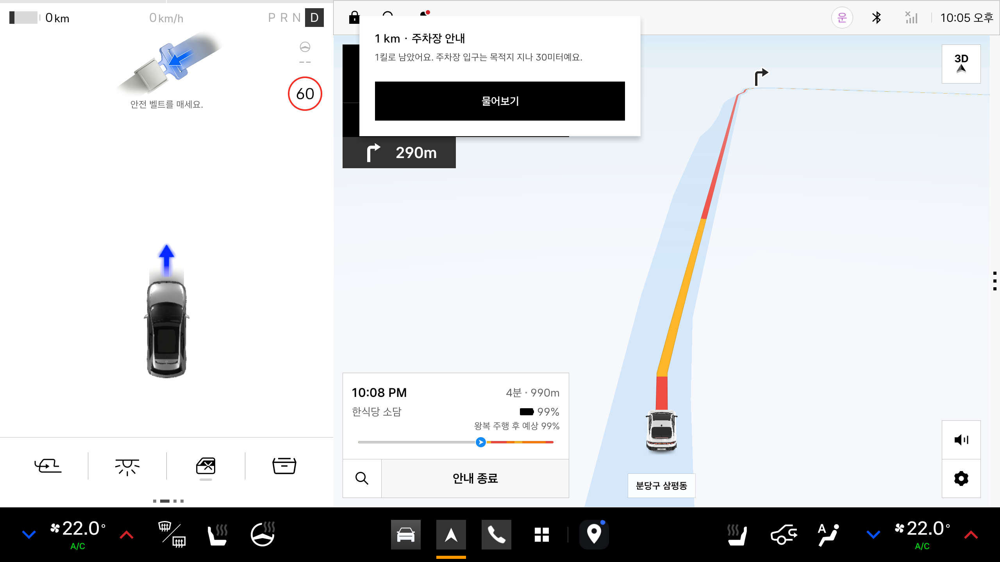
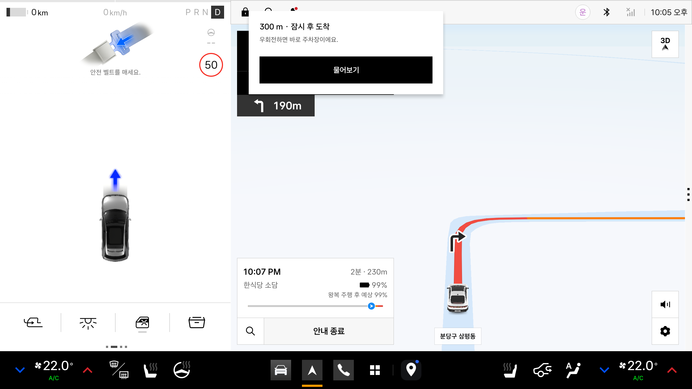
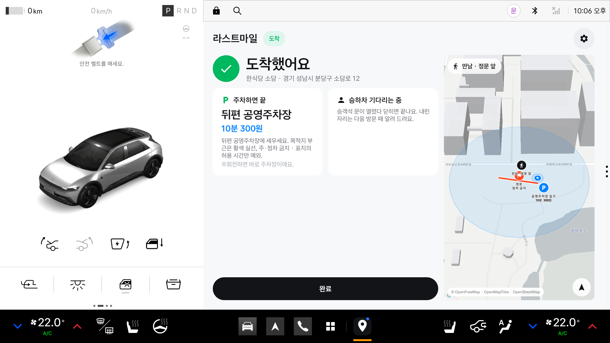
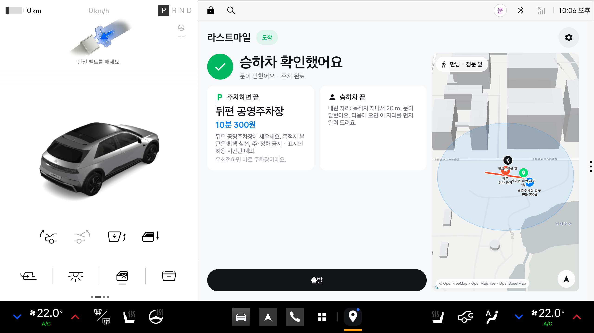
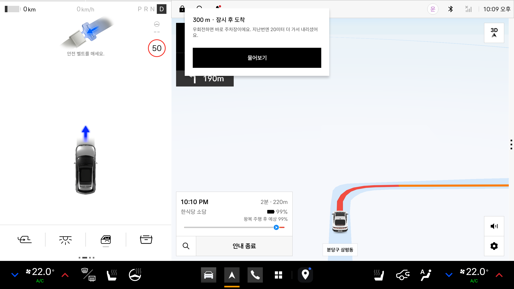

# 라스트마일 (가칭) — 내비가 끝나는 마지막 300 m를 차가 이어받는 앱

> 현대차·기아 차량용 앱 개발 공모전 (2026) 출품작 · Pleos Connect SDK 기반 · 개인 참가

내비가 "목적지 부근입니다"로 끝낸 뒤, 세워도 되는 곳인지(정문 앞 차선·정차 규칙), 어디에 세울지(정차·주차·경유 목적), 정말 멈춰서 내렸는지(기어 P·승객석 문)를 차량 신호로 판단해 한 문장씩 말해 주는 차량용 앱. 멈춘 순간 기다리는 사람에게는 차가 알린다.

**내비가 있는데 왜 또 필요한가.** 내비는 길의 제품이고 이 앱은 멈춤의 제품이다. 내비에게 목적지는 지도 위의 점이지만 운전자에게 목적지는 "세워도 되는 자리"다. 내비는 GPS로 "부근"을 추정하고 끝내지만, 차는 기어 P·승객석 문·브레이크으로 "멈췄다, 내렸다"를 안다. 이 앱은 내비를 대체하지 않고 내비가 끝나는 점에서 시작한다. 내비는 "도착"까지, 라스트마일은 "세우고 내리기"까지.

| 1 km 전 · 내비 위 헤드업 | 300 m 전 · 주차장 입구로 | 기어 P → 도착 확정 (앱이 앞으로) | 문 열림→닫힘 → 승하차 확인 | 두 번째 방문 · 지난번 내린 자리 |
|---|---|---|---|---|
|  |  |  |  |  |

## 앱 이름 · 한 줄 소개
<!-- 제출 규칙 필수 항목 1. 앱명 확정 후 갱신 -->
- **앱 이름:** 라스트마일 (가칭)
- **한 줄 소개:** 내비가 끝나는 마지막 300 m — 세워도 되는지·어디에·정말 멈춰 내렸는지를 차량 신호로 말해 주는 도착 비서. 주행 중 터치 0회.

## 실행 방법
<!-- 제출 규칙 필수 항목 2. 앱 코드 작성 후 채움 -->
1. Android Studio에서 `app/` 열기 (또는 `cd app && ./gradlew assembleSdkDebug`)
2. Pleos Connect Emulator v2.1.0 실행 (설치: `docs/emulator-setup.md`)
3. 빌드 변형: `sdk`(Pleos SDK 연동, 제출용) / `mock`(화면 버튼으로 신호 흉내, 앱 ID `.mock`)
4. 설치 후 `adb shell pm grant --user 10 kr.lastmile.app pleos.car.permission.FUSED_LOCATION` (실행 사용자 ID는 `am get-current-user`)
5. 데모 재현: `scripts/demo.sh` (목적지 선택 → 안내 시작 → 내비 전체 창에서 주행 시뮬레이션, 안내는 음성 + 헤드업 카드 → 도착은 Virtual Console 기어 P). 내비를 움직이는 법은 `docs/emulator-setup.md` §11, 헤드업은 §12

## 테스트 환경 · 필요 설정
<!-- 제출 규칙 필수 항목 3 -->
- Android API 28+, Gradle 8.0+, Kotlin
- Pleos Connect Emulator v2.1.0 (AAOS, API 34) / Vehicle SDK 2.3.2 · NaviHelper 3.0.5 · TTS·STT 3.3.1 · FusedLocation 1.1.3
- 사용 SDK: Vehicle, NaviHelper, TextToSpeech, SpeechToText, FusedLocation
- 차량 신호 연출은 Pleos Connect Virtual Console (`scripts/inject.sh`로 포트 포워딩 후 http://127.0.0.1:8088)
- **지도**: MapLibre(오픈소스) + OpenFreeMap 벡터 타일(키 불필요, 인터넷 필요). 오프라인이면 같은 자리에 도착 구역 스케치(ZoneSketchView)가 대신 표시됨. 경로선은 공개 OSRM 데모 서버(데모용, 응답 없으면 생략)
- **임의 목적지**: 내비에 어떤 목적지를 넣어도 앱이 따라온다. 등록 장소(5곳)는 확인된 정차·주차 데이터로, 그 외는 "일반 도로 기준 5분 이내 정차"로 안내하고 주소(Nominatim 역지오코딩)·가장 가까운 주차장·EV 충전소·정문 앞 도로 방위를 이미 내려받은 지도 타일(OpenStreetMap)에서 찾아 채운다. 추가 키·서버 없음
- **차량 신호 심화**(Vehicle SDK): 목적지 100 m 안에서 브레이크 3초 유지 → 잠시 정차 안내(방향지시등은 우회전마다 오탐이라 쓰지 않음), 승객석 문 열림→닫힘 → 승하차 확인(정차 타이머 종료), EV 배터리 20% 이하 → 충전기 있는 주차장 안내. 권한 `CAR_LIGHTS`·`CAR_DOORS`·`CAR_ENERGY`
- **목적 선택**: 목적지마다 "정차 · 픽업 / 도착 후 주차 / 경유"를 고른다(출발 전 카드와 안내 중 카드의 칩). 정차 금지 장소는 주차가 기본. 주차면 정문 앞을 건너뛰고 주차장·요금·충전기로 바로 안내하고 도착 화면에 정차 타이머가 없다. 경유면 잠깐 멈춰 내리고 문이 닫히면 "다음 목적지로 이어갈게요". 정문 앞 **차선**(흰 실선 = 주·정차 가능, 황색 점선 = 5분 정차, 황색 실선 = 주·정차 금지, 황색 복선 = 절대 금지)을 데이터에 두고 브리핑 문장과 카드에 그대로 말한다. 임의 목적지는 차선 정보가 없어 "황색 점선이면 5분, 실선이면 금지"로 안내
- **도착해서 충전**(EV): 장거리 충전 경유는 내비 EV 경로 플래너의 몫이고, 이 앱은 "도착해서 세우는 동안 충전"만 본다. 배터리 40% 이하면 목적지 반경 500 m 안 충전소 후보(등록 장소의 주차장 충전기 + 지도 타일의 충전소)에서 정문·주차장과의 거리로 1곳을 골라 카드와 3 km 브리핑에 넣고, "경유지 추가" 한 번으로 내비 경로에 넣는다(NaviHelper `addWaypoint`). 내비의 충전 사업자 목록(`getChargerOperatorInfo`)·EV 플래너 충전 경유지(`DrivingInfo`)·후보까지의 가상 경로 도착 잔량(`requestTrip`)을 같이 쓴다. 실시간 빈 충전기·운영기관·출력은 공공데이터포털 키가 있을 때만 붙는다(`app/keys.properties`, 아래 데이터 출처)
- **주행 중 화면 구성**: 안내 시작을 누르면 내장 내비가 전체 창으로 앞에 남고 이 앱은 뒤에서 음성으로 말한다(브리핑·정차·도착·승하차 전부 백그라운드에서 동작 확인). 말한 문장은 **시스템 헤드업 알림**(중요도 HIGH·내비게이션 카테고리)으로 내비 위 왼쪽 위에 제목 + 2줄로 5초 보인다 — "1 km · 주차장 안내 / 1킬로 남았어요. 주차장 입구는 목적지 지나 30미터예요." 카드 아래 **"물어보기" 버튼**을 누르면 앱 화면을 열지 않고(내비를 가리지 않고) 마이크가 한 번 열리고, 답은 음성 + 안내 카드로 돌아온다. 차가 멈춰 도착이 확정되는 순간(기어 P)에만 앱이 스스로 앞으로 나와 정차 타이머·주차장·만남 지점을 보여 준다(Pleos 홈이 BAL_ALLOW_VISIBLE_WINDOW 로 허용). 내비를 대체하지 않고 내비 위에 목소리와 한 줄 글을 얹는 구조. 분할 창도 되지만(반 창 레이아웃 있음) 에뮬레이터 내비가 반 창에서 차량 마커를 자기 카드 뒤에 숨겨 기본 구성에서는 쓰지 않는다
- **승하차 위치 기억**(Vehicle SDK Door + FusedLocation): 도착·잠시 정차 중 승객석 문이 열린 좌표를 "내린 자리"로 목적지별 기기 안에 저장한다(최근 10건, 서버·키 없음). 같은 곳에 다시 가면 출발 전 카드와 안내 카드에 "지난번 · 목적지 지나서 20 m에서 내림 · 3회", 지도에 핀, 300 m 안내에 "지난번엔 20미터 더 가서 내리셨어요"가 붙는다. 3건 이상이면 메도이드(서로 가장 가까운 지점)를 대표로 쓴다. 문 신호는 폰 앱이 가질 수 없는 입력이라 차량 앱마켓 안에서만 쌓이는 데이터. 디버그 빌드는 `am start … --ez clear_drops true` 또는 개발 시트의 "내린 자리 지우기"로 초기화
- **지도 모션**: 3D 건물(타일 render_height)과 목적지 건물 강조, 주행 중 헤딩업·기울임 카메라(easeCamera), 차 마커 스프링 보간, 경로선 그려지기와 지나온 구간 회색 처리, 도착 순간 반경 펄스
- **모션**: 스프링 기반(androidx.dynamicanimation). 페이지·카드·시트 전환, 숫자 카운팅, 진행 바, 누름 반응 모두 현재 값에서 이어지는 스프링(기본 임계감쇠). 시트가 올라오면 뒤 화면은 블러·축소로 밀려남. 지도 위 요소는 유리 재질(반투명 + 하이라이트 테두리)
- APK는 arm64-v8a만 포함 (Pleos 실차·에뮬레이터 모두 arm64)

- **고도화 시 키가 필요한 것**(지도 타일·국내 지오코딩·경로선·충전소 실시간·주차장·정밀도로지도 차선·ElevenLabs/클로바 TTS·LLM 의도 분류·익명 집계·알림톡): 지금은 전부 키 없는 공개 서비스로 돌고, 바꿔 끼울 자리와 순서는 `docs/upgrade-keys.md`

## APK 위치
<!-- 제출 규칙 필수 항목 4. release 서명 빌드 -->
- `apk/김상헌_라스트마일_release.apk` — `cd app && ./gradlew assembleSdkRelease` 로 생성한 서명(v3) 빌드. 서명 키·비밀번호는 `app/keystore/`, `app/keystore.properties`(비공개)

## 시연 영상
- `docs/video/lastmile_demo_1080p.mp4` (189초, 1920×1080, 11/14 재촬영(B 톤 대본) — 헤드업 카드에 "물어보기" 버튼, 앞뒤에 제목·마무리 카드, 화면 왼쪽 위에 장면마다 상황 설명 카드("100 m 안에서 멈춤 — 목적지 100 m 안에서 브레이크를 3초 밟자 '여기 세우려나'로 판단 …"). 앱이 말한 문장을 한국어 신경망 음성(Microsoft Edge 선히)으로 다시 읽어 같은 시각에 얹었고 자막도 함께 보인다. 에뮬레이터 화면 녹화(screenrecord)는 소리를 담지 않아 TTS 를 그대로 녹음할 수 없었다): 에뮬레이터 내비의 주행 시뮬레이션으로 2.6 km 를 실제로 두 번 달린 녹화(원본 7분)에서, 안내가 없는 주행 구간만 8배속으로 돌렸다(오른쪽 위 "▶▶ 주행 구간 8배속" 배지). 주행 중엔 내비가 전체 창이고 라스트마일이 말한 문장이 **내비 위 헤드업 알림**(왼쪽 위, 5초)과 화면 아래 자막으로 보인다 → 목적지 목록·상세(도착 구역 지도 미리보기, 목적 칩) → 안내 시작·출발 브리핑(2.6 km 라 3 km 대신, 배터리 18% 충전기 안내) → 1 km·300 m 헤드업 → 100 m 안 브레이크 정차 헤드업 → 기어 P 도착(앱이 스스로 전체 창으로, 주차장·도착 구역 지도) → 조수석 문 열림·닫힘 → 승하차 확인 + "내린 자리, 기억해 둘게요" → **두 번째 방문**: 같은 목적지 카드에 "지난번 · 목적지 지나서 20 m에서 내림", 지도 핀, 300 m 헤드업에 "지난번엔 20미터 더 가서 내리셨어요"
- 만드는 법: `scripts/demo.sh` 를 돌리며 `adb shell screenrecord --time-limit 0` 로 녹화 → `scripts/captions.py --voice edge:ko-KR-SunHiNeural --rate +10%`(logcat 🔊 줄 → 자막 + 음성 나레이션, `pip install edge-tts`; macOS 내장 음성은 `--voice Yuna`) (녹화는 `scripts/record_demo.sh`) → `scripts/condense.py --scenes scripts/demo_scenes.txt --title "" --closing ""`(자막·장면 캡처 사이 빈 주행 구간 배속, 소리는 1배속 구간만, 장면 라벨 + 제목·마무리 카드). 자세한 순서는 docs/emulator-setup.md §10.

## 저장소 구조
```
docs/                 에뮬레이터 셋업·실험 기록(emulator-setup.md)·데모 대본·UI 설계 노트(ui-design.md)·시연 영상
app/                  Android 프로젝트
apk/                  release APK
scripts/inject.sh     Virtual Console 포트 포워딩
```


## 오픈소스 고지 · 데이터 출처
이 앱은 아래 오픈소스 소프트웨어와 공개 데이터를 사용합니다. 각 라이선스 조건을 따르며, 지도 화면 안에도 출처를 표기합니다.

| 구성 요소 | 용도 | 라이선스 |
|---|---|---|
| [MapLibre Native (Android)](https://github.com/maplibre/maplibre-native) 13.6.1 | 지도 렌더링 엔진 | BSD 2-Clause |
| [OpenFreeMap](https://openfreemap.org) 벡터 타일 · 글리프 서버 | 지도 타일(Positron 스타일) | 서비스는 무료 공개(제한 없음), 코드 MIT |
| [OpenMapTiles](https://openmaptiles.org) 스키마 · Positron 스타일 | 타일 데이터 구조·지도 디자인 | BSD 3-Clause (코드) · CC BY 4.0 (스키마) · Positron 스타일 © CARTO, BSD 3-Clause |
| [OpenStreetMap](https://www.openstreetmap.org/copyright) 기여자 데이터 | 도로·건물·지명 | ODbL 1.0 |
| [OSRM](https://project-osrm.org) 공개 데모 라우팅 서버 | 경로선(데모용, 응답 없으면 생략) | BSD 2-Clause · 경로 데이터는 OSM ODbL |
| Noto Sans (OpenFreeMap 글리프) | 지도 라벨 글꼴 | SIL Open Font License 1.1 |
| AndroidX (core, appcompat, lifecycle, dynamicanimation) · Material Components · Kotlin Coroutines | 앱 프레임워크 · 스프링 모션 · UI 컴포넌트 | Apache License 2.0 |
| Pleos Connect SDK (Vehicle · NaviHelper · TextToSpeech · SpeechToText · FusedLocation) | 차량 신호 · 내비 연동 · 음성 · 위치 | 현대자동차그룹 Pleos Playground 이용 약관 (비오픈소스) |
| [한국환경공단 전기자동차 충전소 정보](https://www.data.go.kr/data/15076352/openapi.do) (공공데이터포털, 선택) | 목적지 주변 충전소 실시간 상태·운영기관·출력·주차료 | 공공누리 1유형(출처 표시). `app/keys.properties` 의 `DATA_GO_KR_KEY` 가 있을 때만 호출, 없으면 기능이 조용히 꺼짐 |

- 앱 아이콘과 화면 아이콘(`res/drawable/ic_*.xml`)은 이 프로젝트에서 직접 그린 벡터 드로어블입니다.
- 데모 목적지 5곳의 상호·주소·좌표·정문/주차장/만남 지점 데이터(`assets/destinations.json`)는 시연용 샘플이며 실제 시설 정보가 아닙니다.
- OpenFreeMap·OSRM 데모 서버는 공개 무료 서비스입니다. 상용 배포 시 자체 타일·경로 서버 또는 유료 플랜으로 교체합니다(`docs/ui-design.md` §5).
